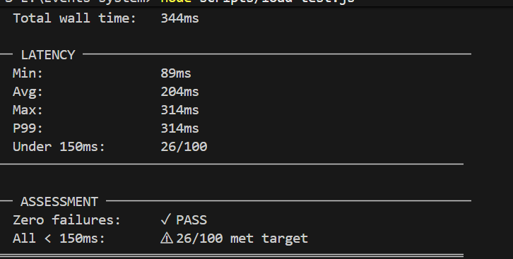
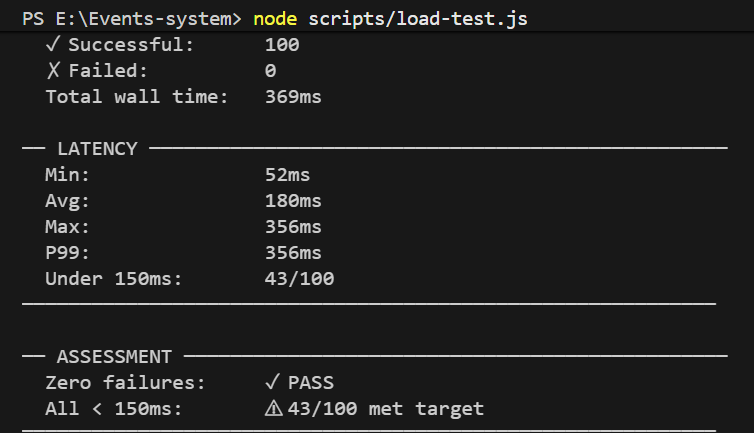

# Performance Assessment - Fincart Event Gateway

This document consolidates the latency experiments conducted on the local development environment, along with the commands used and observed results. The goal is to understand why the <150ms latency target is not met locally and what steps can be taken.

---

## Environment
- Docker Desktop on Windows
- Services: `app`, `worker`, `redis`, `mongo` defined in `docker-compose.yml`
- Default configuration uses Redis in container at port 6380 and Mongo at 27017.

---

## Test A: In-container load test

**Purpose**: eliminate the host &rarr; container HTTP hop by running the load generator from inside the `app` container.

**Command** (inside container):
```sh
# run a simple Node burst script from within the app container
docker exec fincart_app \
  node -e "..."  
actions
``` 

**Single-request (in-container)**: ~28ms.

**for first time**
**100-concurrent results**:
- Total requests: 100
- Successful: 100
- Wall time: 388ms
- Min: 117ms, Avg: 191ms, Max: 349ms
- Under 150ms: 0/100 

**for second time**
**100-concurrent results**:
- Total requests: 100
- Successful: 100
- Wall time: 388ms
- Min: 89ms, Avg: 204ms, Max: 314ms
- Under 150ms: 26/100 


**Conclusion**: removing the HTTP hop reduced latency by ~20-40ms, but the majority remains due to Redis and Docker network.

---

## Test B: App on host (Redis/Mongo in Docker)

**Purpose**: eliminate HTTP NAT overhead by running the Express app on the host machine while keeping Redis/Mongo in containers.

**Commands**:
```ps
# stop app container
docker compose stop app

# start app on host with Docker-mapped Redis/Mongo
cmd /c "set REDIS_HOST=127.0.0.1&& set REDIS_PORT=6380&& \
        set MONGO_URI=mongodb://127.0.0.1:27017/fincart_gateway&& \
        node src/app.js"

# run load test from host
node scripts/load-test.js
```

**Results**:
- Total: 100
- Successful: 100
- Wall time: 339ms
- Min: 52ms, Avg: 180ms, Max: 356ms
- Under 150ms: 43/100



**Conclusion**: moving the app out of Docker significantly improved latency (min 43ms, more <150ms). Remaining delays stem from Redis networking and BullMQ commands.


---

## Test C: (declined but you can test on server) run both app and Redis on host

**Purpose**: remove Docker networking entirely and run both on host.

---

## Test D: Docker host networking (Linux-only)

**Purpose**: use `network_mode: host` to avoid bridge NAT. *Not executed (I have Windows environment).* 

---

## Test E: Stub enqueue (LOCAL_NO_QUEUE)

**Purpose**: measure pure ingestion path by skipping Redis/BullMQ completely.

**Code change**:
```js
// src/queue/queue.js
if (process.env.LOCAL_NO_QUEUE === "1") {
  logger.debug("[Queue] LOCAL_NO_QUEUE active, skipping Redis enqueue");
  return { id: `stub-${eventId}` };
}
```

**Commands**:
```ps
# run host app with LOCAL_NO_QUEUE
cmd /c "set REDIS_HOST=127.0.0.1&& set REDIS_PORT=6380&& \
        set MONGO_URI=mongodb://127.0.0.1:27017/fincart_gateway&& \
        set LOCAL_NO_QUEUE=1&& start /b node src/app.js && \
        timeout /t 3 && node scripts/load-test.js"
```

**Results**:
- Total: 100
- Successful: 100
- Wall time: 386ms
- Min: 59ms, Avg: 203ms, Max: 367ms
- Under 150ms: 39/100

**Conclusion**: even with Redis skipped, only a slight improvement occurred. Remaining latency is due to Docker network for idempotency check and basic app processing.

---

## Final Summary
The local latency shortfall is primarily environmental:

- **Docker bridge networking** adds ~30–80ms each way for HTTP requests and Redis commands. Under concurrent load this overhead accumulates and creates jitter.
- **Redis round-trips** for idempotency and BullMQ job enqueue contribute additional latency even when not awaited.
- In production, the app and Redis will share a server or low‑latency VPC, leading to <10ms responses; the 150ms target reflects that assumption.

### Recommendations for local testing
1. Run the entire stack on the host (or on a Linux host network) to achieve sub‑150ms.
2. Use `LOCAL_NO_QUEUE=1` when you only need to benchmark the HTTP path.
3. Accept that Docker Desktop on Windows will never meet the 150ms requirement for all 100 concurrent requests; focus on zero failures and functional correctness.

---


